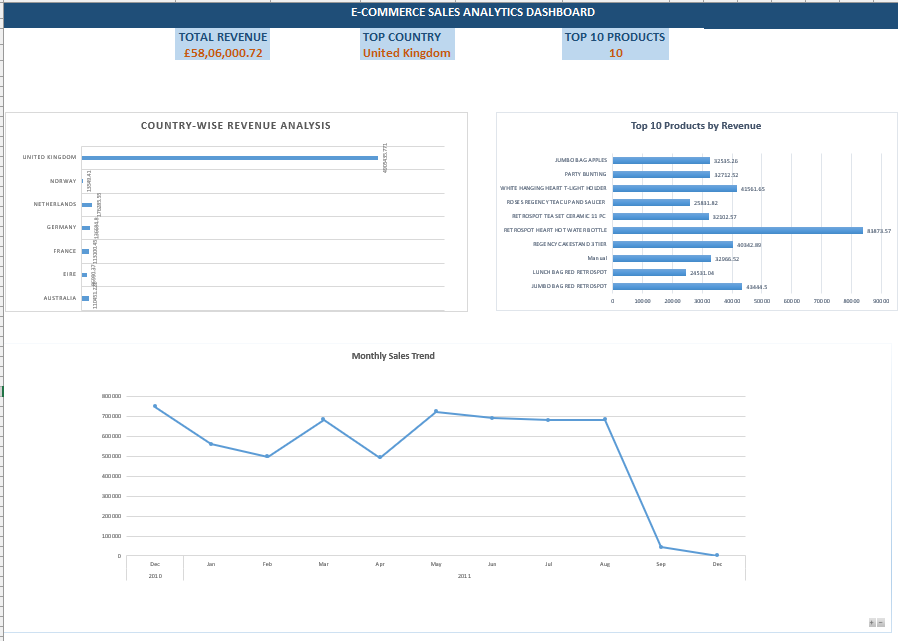

# E-Commerce Sales Analytics Dashboard

## Project Overview
An end-to-end sales analytics project built using Microsoft Excel and the UCI Online Retail dataset. The project analyzes transaction data to identify revenue trends, top-performing products, and country-wise sales performance.

## Dataset
- Source: [UCI Online Retail Dataset](https://archive.ics.uci.edu/dataset/352/online+retail)
- Transaction period: 2010–2011
- Business type: UK-based online retailer

## Tools Used
- Microsoft Excel
- PivotTables
- PivotCharts
- Excel formulas
- Data visualization

## Key Analysis
- Total Revenue
- Country-wise Revenue Analysis
- Top 10 Products by Revenue
- Monthly Sales Trend

## Key Insights
- Identified the highest-revenue country.
- Compared product revenue performance.
- Analyzed monthly revenue patterns.
- Created an interactive-style dashboard for sales monitoring.

## Dashboard
See `Ecommerce_Sales_Analytics_Dashboard.xlsb` in this repository.

## Disclaimer
This project uses publicly available UCI Online Retail data. It is an independent academic portfolio project and is not affiliated with Myntra.

